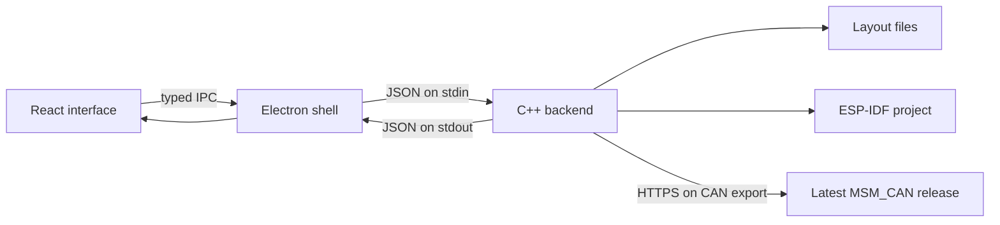

# Architecture

ESPresso has three layers. The renderer edits the diagram; the desktop shell handles Windows integration; the native C++ backend validates, stores and exports the project.

## Renderer

- `src/App.tsx` contains the window shell and canvas composition.
- `src/editor/useEditor.ts` owns UI session state, selection, undo/redo, canvas interactions and calls to the desktop bridge.
- `src/editor/types.ts` defines canvas-specific types.
- `src/screens/` contains task editing, struct editing and export screens. Each screen takes the controller fields it needs through typed props.
- `src/components/` contains reusable graph nodes, forms, empty states and the small MSM_CAN bee mark.
- `src/model.ts` defines the serializable layout and desktop bridge contracts. Renderer types are conveniences; the C++ backend independently checks every project.

Read/write steps define graph connections. Edges are derived from these steps rather than persisted separately, so deleting or reconnecting a wire changes the same data used by the generator. Native code generation never runs in the renderer.

## Desktop shell

- `electron/main.ts` manages the window, native file dialogs, recovery scheduling and close/save handling.
- `electron/preload.ts` exposes a small allowlisted bridge. Context isolation and renderer sandboxing remain enabled; the renderer does not have Node.js access.
- `electron/native-client.ts` starts the native executable without a shell, bounds its response size and enforces request timeouts. The process is hidden on Windows.

The executable path differs between development and packaged builds. The shell keeps this difference out of the renderer and the C++ generator.

## C++ backend

`native/include/espresso/` holds the module interfaces. Implementations are in `native/src/`:

| Module            | Responsibility                                                                            |
| ----------------- | ----------------------------------------------------------------------------------------- |
| `validation.cpp`  | Project shape checks, identifiers, types, literal defaults, task settings and diagnostics |
| `generator.cpp`   | ESP-IDF source, headers, CMake files, mutex helpers and project documentation             |
| `presets.cpp`     | The pressure example and CAN task preset                                                  |
| `storage.cpp`     | Layout reads, writes and atomic saves                                                     |
| `msm_release.cpp` | Resolve the latest stable MSM_CAN release and download source over WinHTTP                |
| `protocol.cpp`    | Dispatch native operations and stage/commit complete exports                              |

`native/main.cpp` is only the stdin/stdout entry point. CMake builds a static `espresso_core` library and the `taskflow-core.exe` process used by Electron. The internal executable name and layout identifiers are retained for compatibility.

The request envelope uses an `op` field. Supported operations are `new`, `example`, `can-preset`, `load`, `save`, `validate`, `preview` and `export`. Responses are either `{ "ok": true, "result": ... }` or `{ "ok": false, "error": "..." }`.

## Export rules

1. Validate the project and reject errors before writing any output.
2. Refuse an export destination that already exists.
3. For CAN layouts, resolve the latest stable GitHub release, pin all downloads to its resolved commit and record the result in `msm_can.lock.json`. Source is downloaded unchanged; there is no cached-source fallback.
4. Write the complete project to a staging folder next to the destination.
5. Rename the completed staging folder into place. Failed exports clean up their staging folder.

Previews do not make network requests. Library source entries explain that the actual released source is fetched during export.

Each generated task owns `setup()` and `loop()`. Shared structs are complete snapshots protected by mutexes. These are not queues: slower readers can skip intermediate samples. Sensor drivers, message IDs and CAN payload packing remain handwritten TODOs.
